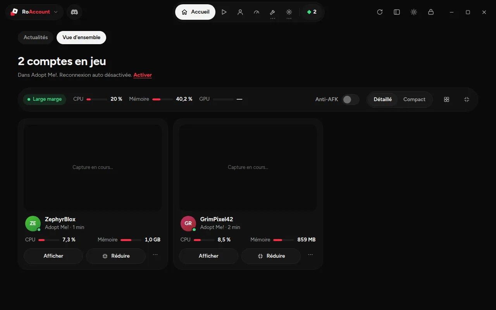
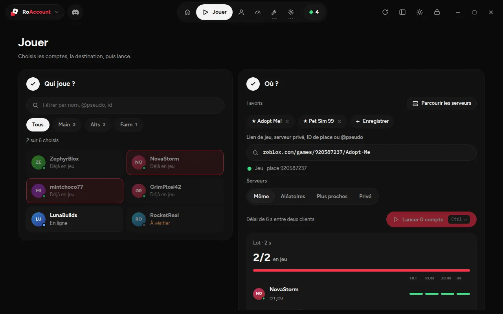
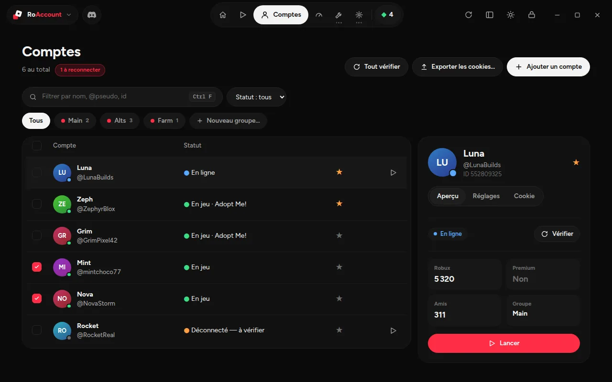
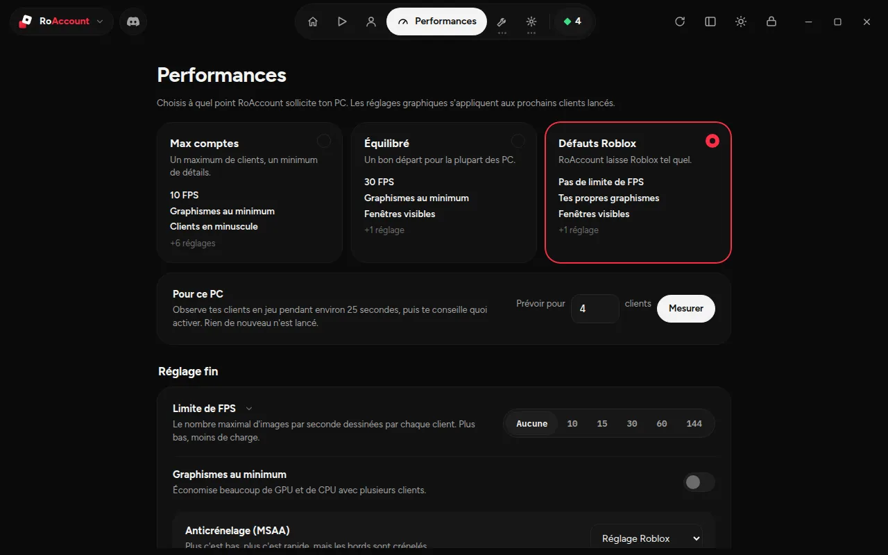
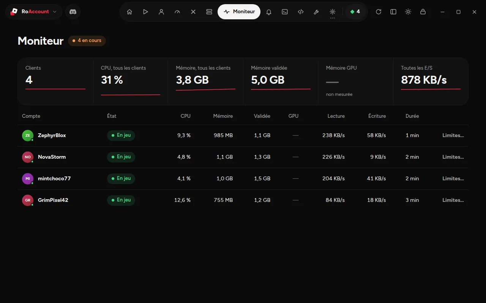

<div align="center">

# RoAccount

**A local Roblox account manager for Windows.**
Encrypted vault, multi-client launching, per-account servers, private servers, macros and live monitoring — everything stays on your PC.

[Website](https://roaccount.xyz) · [Discord](https://discord.gg/u6wWWSUz3G) · [Download](https://github.com/risewulf/RoAccount/releases/latest)

Tauri 2 · Rust · React



</div>

---

## Download

1. Open the **[Releases](https://github.com/risewulf/RoAccount/releases/latest)** page.
2. Download **`RoAccount_x.y.z_x64-setup.exe`** and run it.
3. *(Optional)* Verify the file. In PowerShell, from the folder you downloaded it to:

   ```powershell
   Get-FileHash .\RoAccount_0.2.0_x64-setup.exe -Algorithm SHA256
   ```

   The hash must match the one printed in the release notes.
4. If Windows shows *"Windows protected your PC"* (SmartScreen), click **More info → Run anyway**. The installer is not code-signed yet — all the source is here so you can check it, or build it yourself.

> **Important:** close every Roblox client **before** starting RoAccount. Multi-client only works if RoAccount starts first.

The interface is in English.

## What it does

<table>
<tr>
<td width="50%"></td>
<td width="50%"></td>
</tr>
<tr>
<td align="center"><sub>Play — pick accounts, pick a destination, watch the batch start</sub></td>
<td align="center"><sub>Accounts — table, groups, per-account panel</sub></td>
</tr>
<tr>
<td></td>
<td></td>
</tr>
<tr>
<td align="center"><sub>Performance — presets and fine-tuning</sub></td>
<td align="center"><sub>Monitor — CPU, memory and disk per client</sub></td>
</tr>
</table>

### Home
Live view of every running client: a window preview, the game, uptime, CPU and memory, with **Show** / **Minimise** and per-client mute or priority. System load at a glance, an **Anti-AFK** switch, a detailed or compact layout, and one-click **Tile** / **Minimise all**. A News tab shows project news and whether your Roblox client is up to date.

### Play
A two-step launcher. **Who plays?** — filter by name or group and pick accounts (the MAIN account stays out of batches unless you pick it). **Where to?** — paste a game link, a private server link, a place ID or an `@username` to follow, and choose how servers are assigned:

| Mode | What happens |
|---|---|
| Same | Every account joins the same server |
| Random | Each account gets a different public server |
| Closest | Each account gets one of the lowest-ping servers |
| Private | Everyone joins your private server |

A live batch panel shows each account moving through ticket → client started → joining → in game, and the batch can be cancelled.

**Launch profiles** save "these accounts + this game + this server mode + this delay" so you can start them again in one click, and **scheduling** starts or stops a profile at a given time (RoAccount must stay open, it can be minimised to the notification area). A profile can also start by itself when RoAccount opens.

### Accounts
**Check all** tests every cookie at once and reports which ones are valid, expired or unreachable. Drag accounts onto a group chip to move them. Search, filter by status, organise into groups, colour tags and favourites. The side panel has **Overview** (status, game, Robux, Premium, friends), **Settings** (alias, note, group, colour, MAIN account) and **Cookie** (reveal with confirmation, remove). Switch to a **side list** layout from the title bar.

### Performance
Three presets — **Max accounts**, **Balanced**, **Roblox defaults** — plus fine-tuning:
- FPS cap, lowest graphics, MSAA, texture quality, render mode, grey sky, no grass (written to Roblox's `ClientAppSettings.json`, applied to the next client you launch);
- minimise / start tiny / mute on launch;
- adaptive priority for background clients, spreading clients across CPU cores, periodic memory trimming, throttling or restarting a client above a memory threshold;
- **For this PC**: watches your running clients for ~25 s and recommends a preset for the number of clients you plan to run;
- **Share your config**: copy or paste a share code, save to a file, load from a file.

### History
Play time per account and per day (last 7 days), launches, closes, automatic restarts and failures, a filterable event log and CSV export. Stored only on your PC for 60 days.

### Command palette
`Ctrl+K` — type "launch luna", "monitor", "lock"… to go anywhere or run anything without leaving the keyboard.

### Servers
Browse public servers by ping or fill level, hide full ones, pick one and send any accounts into it. The **Private** tab lists, buys, renames and manages your private servers.

### Monitor
Six live totals with sparklines (clients, CPU, memory, committed memory, disk I/O) and a per-account table. Per-client priority and mute.

### Discord
Webhook alerts with an optional `@mention` for: launches, crashes, frozen clients, disconnects, automatic reconnects and restarts, memory restarts, give-ups, batch finished, and a periodic status summary.

### Tools & Macros
Make your accounts friends with each other, import from Roblox Account Manager (JSON or plain cookies), export cookies, and run **AutoHotkey v2** scripts on your clients (each client's PID is passed as `A_Args[1]`).

### Debug
A live log of what RoAccount does (errors, warnings, info, debug), filters, pause and **Copy diagnostic** for support.

### Settings
- **Launch** — start with Windows (optionally minimised), profile launched at startup, Roblox update alert, multi-instance, launch delay, launch arguments, reconnect / restart on crash, give up after N tries in M minutes, Anti-AFK, emergency hotkey, graceful-close delay, scheduled PC shutdown, Roblox client version.
- **Appearance** — dark, light or system theme, any accent colour (RoAccount red by default), density, tab layout, sounds, animations, minimise to the notification area.
- **Security** — change the master password, auto-lock after inactivity, clear the clipboard after copying a cookie.
- **Data** — open the data folder, encrypted backup, account info cache, clean Roblox logs, empty the Roblox cache.
- **Keyboard shortcuts** — `Ctrl+K` command palette, `Ctrl+1…9` to switch pages, `Ctrl+N` add an account, `Ctrl+F` search, `Ctrl+Enter` play, `Ctrl+L` lock, `F5` refresh, `?` for the full list.

## How multi-client works

Roblox only allows one client at a time through a Windows lock (a *mutex* named `ROBLOX_singletonEvent`). At startup RoAccount creates that lock before Roblox does and keeps it open, so clients start side by side.

For each account the app asks Roblox for a one-time **login ticket** (using the account's cookie), then opens the matching `roblox-player:` link: Windows starts a client that is already logged in. RoAccount remembers which process belongs to which account, which is what powers the per-account Monitor and Home cards.

Count roughly 1 to 1.5 GB of RAM per client.

## Security & privacy

- Use it **only with accounts you own**.
- Cookies are encrypted locally with **AES-256-GCM**, using a key derived from your master password with **Argon2id**. Nothing is stored in plain text. There is **no recovery code**: lose the password and the vault is unreadable.
- Cookies **never leave your machine**. RoAccount only talks to the official `*.roblox.com` APIs, to `roaccount.xyz/news.json` (a plain download for the News tab) and to the Discord webhook you configure.
- Never share your `.ROBLOSECURITY` cookie or your vault file. Cookie exports are plain text: store them carefully.
- Independent project, not affiliated with Roblox Corporation. Use at your own risk: Roblox's rules apply to your accounts.

### Code signing policy

Free code signing provided by [SignPath.io](https://about.signpath.io), certificate by [SignPath Foundation](https://signpath.org). *(Applied for — until it is approved, releases are unsigned and Windows shows "Unknown publisher".)*

- Only builds produced from this repository by the [GitHub Actions workflow](.github/workflows/release.yml) are submitted for signing. Nothing is built or signed locally.
- **Team roles:** author, reviewer and approver — [@risewulf](https://github.com/risewulf).
- Signing requests for releases are approved manually.

### Privacy policy

RoAccount does not collect, track or send any personal data to the author. It stores everything locally, and only contacts the services listed above. This program will not transfer any other information to other networked systems unless specifically requested by the user or the person installing or operating it.

## Known limitations

- **GPU usage** (total and per client) is not measured yet — those fields show "—".
- **Per-client CPU caps** and **bandwidth limits** are not implemented (Windows needs job objects or a network driver for that).
- **Graphics options** work by editing Roblox's client settings file. Roblox decides which settings it honours and may ignore some.
- Clients started *outside* RoAccount have no preview and no per-account stats, because RoAccount cannot tell which account they belong to.
- **Stop all** also closes the MAIN account's client — Windows does not say which process belongs to which account.
- Private-server buying and management use Roblox endpoints that can change; treat them as best effort.

## Getting a cookie

Easiest: **Add account → Roblox login** signs in inside RoAccount and captures the cookie for you. Manual way: in a browser signed in to Roblox, developer tools → Application → Cookies → `roblox.com` → copy the value of `.ROBLOSECURITY`, then paste it in **Add account → Paste a cookie**.

## Development

**Requirements:** Node.js 20+, stable Rust, Visual Studio Build Tools ("Desktop development with C++" workload), WebView2.

```bash
npm install

# UI only, in the browser, with a mocked backend (sample data, nothing is launched)
npm run dev

# full app (front end + Rust backend)
npm run tauri dev

# build the installer (src-tauri/target/release/bundle/nsis/)
npm run tauri build
```

### Publishing a release

The [`release.yml`](.github/workflows/release.yml) workflow builds the installer on GitHub Actions. Pushing a `vX.Y.Z` tag builds it and publishes it to Releases; a manual run (*Actions → Build & Release → Run workflow*) produces a test build available as an artifact.

```bash
# 1. bump the version in package.json, src-tauri/Cargo.toml and src-tauri/tauri.conf.json
# 2. then:
git tag v0.3.0
git push origin v0.3.0
```

### Project layout

```
roaccount/
├─ src/                      # React front end
│  ├─ App.tsx                # shell, keyboard shortcuts, auto-lock, Anti-AFK, emergency hotkey
│  ├─ styles/                # theme.css (design tokens, accent) + global.css
│  ├─ lib/                   # api.ts (typed bridge + browser mock), hooks, ui helpers
│  ├─ components/            # Shell (title bar + pill nav), AccountSide, Controls…
│  └─ views/                 # Accueil, Jouer, Comptes, Perf, Serveurs, Moniteur, Discord, Debug, Settings…
└─ src-tauri/                # Rust backend
   └─ src/
      ├─ vault.rs            # encrypted vault
      ├─ roblox.rs           # Roblox API client
      ├─ launch.rs           # launching through the authentication ticket, graceful stop
      ├─ singleton.rs        # multi-instance (Roblox mutex)
      ├─ perf.rs             # live metrics, graphics settings, Roblox version
      ├─ winmgmt.rs          # windows, priority, mute (WASAPI), freeze detection, CPU affinity, memory trim
      ├─ background.rs       # auto-reconnect / restart, performance engine, status summary
      ├─ macros.rs · tools.rs · discord.rs · settings.rs · state.rs
      └─ commands.rs         # commands exposed to the UI
```

## License

[MIT](LICENSE) © Risewulf
